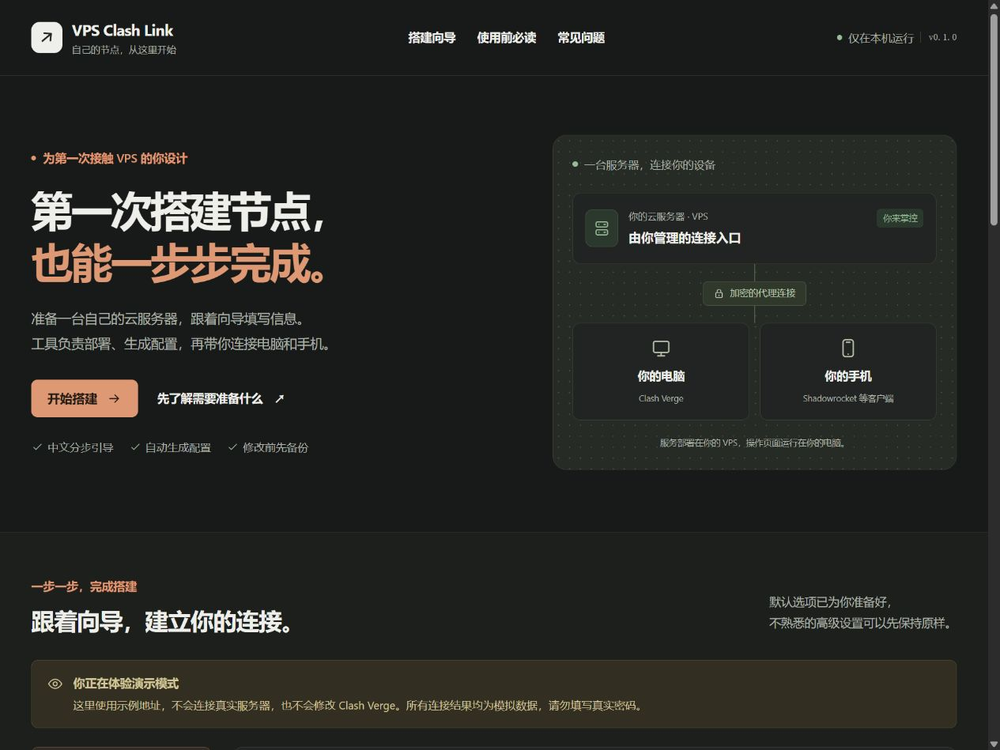
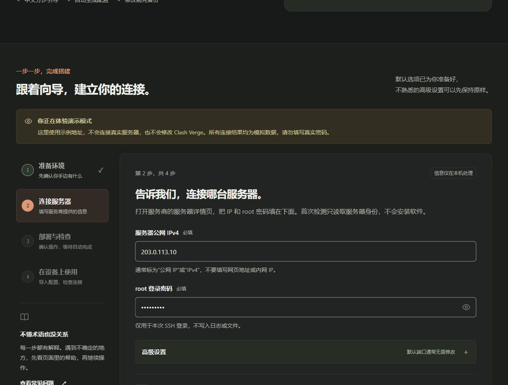

# VPS Clash Link

**让第一次接触 VPS 的人，也能跟着中文向导搭建并使用自己的节点。**

[](https://github.com/ByteVital/vps-clash-link/actions/workflows/ci.yml)


这个项目来自一次真实的 VPS 配置经历：有了 IP 和 SSH 密码，还需要检查服务器、部署代理、生成客户端配置，最后确认流量确实经过自己的服务器。VPS Clash Link 把这些步骤整理成一个运行在本机的中文工具。

目前是 **v0.1.0 预览版**，采用 **Shadowsocks 2022 + sing-box**。自动导入面向 Windows 上的 Clash Verge Rev 标准安装版，其他系统可以下载配置手动导入。

## 项目为什么存在

对第一次购买 VPS 的人来说，拿到服务器 IP 只是开始：SSH、协议、端口、配置文件和客户端导入之间，还有一段容易卡住的路。这个项目把这些步骤串起来，并在操作发生之前解释它要做什么，在完成之后说明下一步如何使用。

你提供自己服务器的连接信息，工具完成可自动化的部署与配置工作。你仍然掌握服务器、防火墙和客户端的选择，也能查看运行结果、下载配置和找到备份位置。

它适合希望了解并管理自己节点的新手，也适合学习 Node.js、SSH 自动化和客户端配置集成的开发者。当前版本需要在终端运行 Node.js 项目，尚未提供双击安装的桌面应用。

## 目录

- [功能](#功能)
- [界面预览](#界面预览)
- [快速开始](#快速开始)
- [第一次使用：详细指南](#第一次使用详细指南)
- [怎么看部署结果](#怎么看部署结果)
- [常见问题与排查](#常见问题与排查)
- [实现方式](#实现方式)
- [数据与恢复](#数据与恢复)
- [测试与验证范围](#测试与验证范围)
- [已知限制](#已知限制)
- [参与开发](#参与开发)
- [后续方向](#后续方向)

## 功能

- 四步中文向导：准备环境 → 连接服务器 → 部署与检查 → 在设备上使用。
- 本地操作页，配有准备清单、术语解释和常见问题，无需把 SSH 密码交给远程面板。
- 先读取 SSH 主机指纹，核对后连接；已记住的主机密钥变化时停止。
- 支持 Ubuntu / Debian，使用独立的 systemd 服务部署代理。
- 优先复用现有 ELF 格式 sing-box 二进制；没有时下载官方稳定发行包，并核对 GitHub 提供的 SHA-256 摘要。
- 写入前检查端口、备份项目管理的旧配置，启动失败时恢复原配置和服务状态。
- 导出 Mihomo/Clash YAML、标准 SS2022 分享链接、手机扫码二维码。
- 检测本机 Mihomo 内核，启动临时代理核对出口 IP 和 Google HTTP 204 响应。
- Windows 下备份 Clash Verge 设置、新增独立本地配置、重启客户端，再验证客户端代理端口。
- 无服务器演示模式，可直接查看完整交互。
- 明确说明费用、线路限制、防火墙、备份及凭据保管；设备结果页分别提供电脑和手机使用步骤。
- 页面刷新后尝试恢复当前本地任务，不会因刷新自动重新部署；浏览器只临时保存任务编号。

## 界面预览





> 截图为演示模式；示例地址属于文档保留网段，连接结果是模拟数据。

## 快速开始

本机需要 **Node.js 22 或更新版本**。Windows 自动导入需要先安装并启动过 Clash Verge Rev。

如果你还没有这些工具，可从 [Node.js 官网](https://nodejs.org/en/download)、[Git 官网](https://git-scm.com/downloads)和 [Clash Verge Rev 官方发布页](https://github.com/clash-verge-rev/clash-verge-rev/releases/latest)获取。安装 Node.js 和 Git 后，重新打开终端，确认下面的命令能够显示版本号：

```bash
node --version
npm --version
git --version
```

在本机终端执行：

```bash
git clone https://github.com/ByteVital/vps-clash-link.git
cd vps-clash-link
npm ci --ignore-scripts
npm start
```

浏览器打开 **http://127.0.0.1:3066**。

1. **准备环境**：确认自己的 VPS 使用受支持系统，准备公网 IPv4、root 登录密码和客户端。
2. **连接服务器**：填写 IP 和密码，点击“检测服务器”，核对并确认主机指纹。高级设置可修改 SSH 端口和节点端口，节点默认 `18443`。
3. **部署与检查**：核对目标和端口，按需选择自动导入与系统代理，阅读授权后点击“开始部署节点”。
4. **在设备上使用**：查看连接验证结果，按电脑或手机页签中的说明导入配置；连接失败时查看页面内的排查方法。

**先在 VPS 服务商的云防火墙中放行代理端口的 TCP/UDP。** 工具不会修改 SSH 配置、防火墙规则或服务商安全组。

仅体验界面和导出流程：

```bash
npm run demo
```

演示模式使用合成的连接信息，不连接 SSH、不安装服务、不修改本机 Clash Verge。请不要在演示页面输入真实密码。

演示模式和真实模式使用同一个默认端口。切换时先在原终端按 `Ctrl+C` 停止工具，再运行另一条启动命令。停止本机页面不会停止已经部署在 VPS 上的服务。

### 环境要求

| 项目 | 当前支持范围 |
| --- | --- |
| 本机 | Node.js 22+；导出功能跨平台 |
| 自动导入 | Windows、Clash Verge Rev 标准安装目录及标准用户数据目录 |
| VPS | Ubuntu / Debian、Python 3.9+、systemd、`ss` 命令 |
| 架构 | 下载内核时支持 amd64 / arm64 |
| SSH | root + 密码；每次连接都校验已确认的主机指纹 |
| 代理 | IPv4、Shadowsocks 2022 `2022-blake3-aes-128-gcm`、TCP / UDP |

SSH 密钥登录、IPv6、macOS 自动导入和更多代理协议暂未实现。

导出跨平台不代表每个平台都支持自动验证：当前版本通过 Windows 的 Clash Verge 安装目录寻找 Mihomo 内核，未找到时仍生成配置，并提示手动导入验证。

### 可选设置

| 环境变量 | 用途 |
| --- | --- |
| `PORT` | 修改本地操作页端口，默认 `3066` |
| `VPS_CLASH_DATA_DIR` | 修改运行数据目录，默认项目下的 `runtime/` |
| `CLASH_VERGE_EXE` | Windows 下显式指定已安装的 `clash-verge.exe` 路径 |

例如 PowerShell：

```powershell
$env:CLASH_VERGE_EXE = 'D:\Apps\Clash Verge\clash-verge.exe'
npm start
```

## 第一次使用：详细指南

### 先认识三个词

| 名称 | 可以怎样理解 | 在本项目中的作用 |
| --- | --- | --- |
| VPS | 你租用的一台远程电脑 | 持续运行代理服务，需要自行续费 |
| 节点 | 安装在这台远程电脑上的代理服务 | 由服务器地址、端口、协议和节点密钥组成 |
| 客户端 | 电脑或手机上的连接工具 | 导入节点配置，再按规则转发应用流量 |

服务器 root 登录密码和节点密钥用途不同。前者用于管理服务器，由你提供；后者由工具生成，保存在节点配置里，供客户端连接。请分别保管。

### 第 1 步：准备环境

在 VPS 服务商后台打开服务器详情，准备以下内容：

- **公网 IPv4**：填写服务器地址本身，不带 `http://`、路径或端口。本项目截图中的 `203.0.113.10` 是文档示例地址，不能用于真实连接。
- **root 登录密码**：通常由服务商提供或由你创建。它不是服务商网站账号密码。如果服务器只允许 SSH 私钥登录，当前版本无法直接使用。
- **SSH 端口**：默认 `22`；如果你修改过，使用实际端口。
- **受支持的系统**：Ubuntu / Debian，并已有 Python 3.9+、systemd 和 `ss`。工具不会自动补装缺失的系统依赖。
- **客户端**：Windows 自动导入需要先安装并启动过 Clash Verge Rev；手机需要支持 Shadowsocks 2022 的客户端。

新手建议先使用没有重要业务的 VPS，并在服务商后台创建快照。VPS 的租金、续费与超额流量可能产生费用，请先确认套餐规则。

### 第 2 步：连接服务器

1. 在向导中填写公网 IPv4 和 root 密码。
2. 不熟悉端口设置时，先保留默认值；如果 SSH 端口不同，在“高级设置”里修改。
3. 点击 **“检测服务器”**。这一步读取 SSH 主机身份，不会安装代理，也不会修改服务器。
4. 核对页面显示的 `SHA256:` 主机指纹，确认是自己要管理的服务器，再勾选确认。
5. 点击 **“确认信息，下一步”**。

主机指纹用于确认 SSH 连接的对端身份。可以查看服务商提供的指纹，或通过服务商独立的网页控制台登录服务器，运行下面的只读命令，核对对应主机密钥的 SHA256 指纹：

```bash
for file in /etc/ssh/ssh_host_*_key.pub; do
  ssh-keygen -lf "$file"
done
```

不要只因为页面显示了一个指纹就认为身份已经核实。已记录的指纹发生变化时，工具会停止；先确认是否重装过系统或更换过主机密钥，再处理记录。

### 第 3 步：部署与检查

确认摘要中的目标服务器、SSH 端口和节点端口。**SSH 默认端口是 `22`，节点默认端口是 `18443`，两者用途不同，不能设置为相同值。**

在服务商的云防火墙或安全组中允许访问节点端口的 **TCP 和 UDP**；如果 VPS 内部也启用了防火墙，还需相应放行。请按服务商和系统的说明操作，保留已有的 SSH 管理通道。工具不会关闭防火墙、修改安全组或更改 SSH 设置。

然后按需要选择：

- **自动导入 Clash Verge**：连接验证通过且检测到客户端后，先备份设置，再新增本地配置并重启客户端。验证未通过时暂停自动导入。
- **同时开启系统代理**：仅与自动导入搭配使用，影响支持系统代理的本机应用。需要全设备接管、TUN 或其他分流方式时，应在客户端中自行了解并设置。

阅读操作授权后点击 **“开始部署节点”**。向导会依次展示环境检查、服务部署、配置生成和连接验证。请保持启动工具的终端运行，避免同时运行其他节点安装脚本。

一次只运行一个部署任务。不要通过反复点击、刷新或重启工具来重试不明确的失败；先查看当前阶段和提示。

### 第 4 步：在电脑上使用

**已自动导入并验证：** 打开 Clash Verge，确认选中了新生成的 `VPS-<服务器地址>` 节点，检查“系统代理”开关，再打开浏览器测试。没有选择自动开启系统代理时，需自行打开该开关。

**需要手动导入：**

1. 在结果页下载 `clash.yaml`。
2. 打开 Clash Verge 的“订阅”页，创建或导入本地配置；菜单名称可能随客户端版本变化。
3. 选择这份配置，并在 `Proxy` 分组中选中 VPS 节点。
4. 开启“系统代理”，用浏览器检查连接。

默认规则只将私网、回环地址和 `.cn` 域名设为直连，其余走 `Proxy` 分组。它不是完整的国内外分流方案，请根据自己的需求调整。

### 第 4 步：在手机上使用

1. 在结果页切换到 **“在手机上使用”**。
2. 打开 Shadowrocket 或其他支持本项目 Shadowsocks 2022 加密方式的客户端。
3. 用客户端的扫描功能导入二维码，选择节点并开启连接。
4. 首次连接需要手机系统授权时，按客户端和系统提示操作，再用浏览器测试。

如果二维码已经保存在同一部手机中，可以从客户端相册扫描入口导入。也可以下载 `node.txt`，使用客户端支持的链接导入功能。手机客户端的安装和费用由使用者自行处理，本项目不附带这些客户端。

操作页只监听当前电脑的回环地址，手机不能用自己的 `127.0.0.1:3066` 访问电脑页面。推荐在电脑上显示二维码让手机扫描，或通过私密方式把配置传到自己的手机。

二维码、链接和 YAML 都包含节点密钥。不要把它们贴进公开 Issue、截图、群聊或代码仓库。

## 怎么看部署结果

| 页面状态或信息 | 含义 | 下一步 |
| --- | --- | --- |
| 演示数据 | 只展示模拟流程和示例结果 | 使用真实 VPS 前停止演示，再运行 `npm start` |
| 验证通过 | 已通过本次要求的出口和 HTTP 检查；选了自动导入时还要求客户端复测通过 | 根据设备说明连接，再测试自己的应用 |
| 需要检查 | 配置已经生成，但网络或客户端检查未全部通过 | 查看提示，核对防火墙、线路、出口 NAT 和客户端 |
| 任务失败 | 流程某一步未完成 | 先确认失败阶段、服务器状态和备份位置，再决定是否重试 |
| 当前出口 IP | 检测服务返回的代理出口地址 | 当前实现要求与输入的 VPS IPv4 一致；出口 NAT 可能导致不一致 |
| 网页连接测试耗时 | 本次通过代理请求 Google 检测端点的耗时 | 用于本次连接诊断，不是带宽测速或稳定的延迟评测 |

节点部署成功、网络验证通过和某个网站的账号资格是不同事情。工具无法保证第三方服务可用，也不会改变 IP 信誉、账号关联地区或线路质量。

刷新页面只尝试恢复**同一浏览器会话、同一运行中工具进程**里的任务，不会自动提交新部署。工具重启后任务状态会丢失，但已经生成的文件通常仍在本地 `runtime/jobs/` 中；不要据此判断服务器服务已停止。

## 常见问题与排查

| 现象 | 优先检查 |
| --- | --- |
| `node`、`npm` 或 `git` 命令无法识别 | 是否已安装相应工具；安装后重新打开终端，检查版本命令 |
| 页面打不开 / 本机服务无法启动 | 启动终端是否仍运行、URL 和 `PORT` 是否一致、端口是否被另一个实例占用 |
| 检测服务器超时 | VPS 是否开机、公网 IP 与 SSH 端口是否正确、云防火墙是否允许 SSH |
| SSH 认证失败 | 是否使用 root 的服务器密码、是否误带空格、服务器是否允许 root 密码登录 |
| 主机指纹变化 | 是否重装或更换了服务器；通过服务商独立控制台核对，勿盲目删除记录 |
| 系统或依赖不支持 | 是否为支持的 Ubuntu / Debian，且具备 Python 3.9+、systemd 和 `ss` |
| 节点端口已被占用 | 选择其他未占用端口，并同步放行防火墙；不要直接停止不认识的服务 |
| 内核下载或摘要检查失败 | VPS 能否访问 GitHub、API 配额是否耗尽、官方发行包是否提供摘要；不要跳过校验 |
| 服务已启动但连接失败 | 节点端口的云防火墙和系统防火墙、运营商线路、客户端协议支持、服务器出口 NAT |
| 没有检测到 Clash Verge | 先安装并启动客户端，确认安装目录；可设置 `CLASH_VERGE_EXE`，或下载配置手动导入 |
| 自动导入被暂停 | 先处理连接验证提示；没有 Mihomo 内核也会导致自动验证不可用 |
| 已导入但浏览器仍不能访问 | 是否选中新配置和节点、系统代理是否开启、是否有其他代理软件影响当前连接 |
| 手机无法导入 | 客户端是否支持 `2022-blake3-aes-128-gcm`，以及链接或二维码是否完整 |

**不要同时启动多个系统代理客户端来排查同一个问题。** 先确认当前使用的软件、节点和代理开关。重装 VPS 不是本项目的排查步骤。

服务端只读检查命令，可在自己的 SSH 终端或服务商网页控制台执行：

```bash
systemctl status vps-clash-link --no-pager
journalctl -u vps-clash-link -n 50 --no-pager
ss -lntu
```

需要反馈问题时，请提供系统版本、Node.js 版本、客户端版本、失败阶段和脱敏后的错误文本。公开截图前遮住真实 IP、账号、节点链接、密钥、二维码和个人目录信息。不要公开完整 `runtime/`、服务器配置或 root 密码。

## 实现方式


技术栈：Node.js 原生 HTTP 服务、原生 HTML/CSS/JavaScript、ssh2、YAML、QRCode；远端执行 Python 标准库脚本。页面无需前端构建，运行数据与源码分离。

```text
public/              中文本地操作页
src/server.js        本机 HTTP API、会话和请求校验
src/ssh.js           主机指纹、SSH 连接和 JSONL 执行通道
src/workflow.js      部署、导出、验证和导入的任务流程
src/profiles.js      YAML、SS2022 链接及二维码生成
src/windows.js       Clash Verge 配置备份与导入
src/verify.js        临时 Mihomo 与实际出口验证
remote/deploy.py     远端检查、安装、部署和异常恢复
scripts/             Windows 进程控制与发布前检查
test/                本地 API、导出、导入和远端事务测试
runtime/             本机生成的敏感运行数据，Git 忽略
```

### 服务端文件

| 路径 | 用途 |
| --- | --- |
| `/etc/vps-clash-link/config.json` | 本项目的代理配置，包含节点密钥 |
| `/etc/vps-clash-link/managed.json` | 管理标记，避免覆盖不属于本项目的配置 |
| `/etc/systemd/system/vps-clash-link.service` | 独立服务 |
| `/usr/local/lib/vps-clash-link/sing-box` | 首次下载的内核；复用现有内核时不创建 |
| `/var/backups/vps-clash-link/` | 修改前的配置、服务单元与状态备份 |

项目不会接管现有的 `sing-box.service` 或 `xray.service`。端口冲突会停止部署。重复部署保留本项目已有节点密钥，避免让其他设备的配置失效。

## 数据与恢复

### 哪些数据保存在什么地方

| 数据 | 保存位置 | 注意事项 |
| --- | --- | --- |
| SSH 登录密码 | 本次认证流程的进程内存 | 应用不主动写入日志、任务文件或浏览器存储；这不等同于内存取证防护 |
| 可信主机指纹 | `runtime/known-hosts.json` | 关联服务器地址，不要盲目重置 |
| YAML、链接和二维码 | `runtime/jobs/<任务编号>/` | 含节点密钥，未加密存储 |
| Clash Verge 导入前备份 | `runtime/backups/` | 可能包含既有订阅与本机设置，也需要私密保存 |
| 当前任务状态 | 本机工具进程内存 | 工具重启后不保留；浏览器临时保存的任务编号不能恢复整个进程 |
| 服务端节点配置和备份 | 上文所列服务端目录及结果页备份路径 | 部署后仍需自行管理服务器访问权限 |

### 备份和恢复的边界

- **SSH 密码**用于本次内存中的 SSH 认证，不写入任务状态、日志或文件。
- **节点密钥**必须存在于服务端配置及导出的 YAML/链接/二维码中；这些文件不是加密存储。
- 本地服务固定监听 `127.0.0.1`，校验 Host、Origin、会话 Cookie 和写请求令牌，不应被转发到公网。
- `runtime/` 包含节点凭据、主机指纹和本机配置备份；不要上传、分享或放入网盘同步的公开目录。Unix 使用受限文件权限；Windows 文件权限继承当前用户目录设置。
- 服务端候选配置检查失败时不替换旧配置；写入后启动或启用失败时恢复备份及原运行状态。首次下载的内核和备份目录会保留。
- 服务端部署成功后，如果本机导出、验证或导入失败，**服务端代理仍然保留**；不会在不明确服务器状态时自动删除服务。
- 本机导入失败会尝试恢复订阅索引和设置。成功导入后，旧订阅仍保留，可在 Clash Verge 中切回；原始文件也在 `runtime/backups/` 中。

服务状态可在服务器查看：

```bash
systemctl status vps-clash-link --no-pager
journalctl -u vps-clash-link -n 50 --no-pager
```

如需停止本项目服务，可在服务器执行：

```bash
systemctl disable --now vps-clash-link
```

该命令停止代理并关闭开机启动，不删除配置，也不卸载其他代理服务。需要再次启用时：

```bash
systemctl enable --now vps-clash-link
```

恢复到部署前状态时，请参考对应备份目录内的 `state.json`，先停止服务再恢复文件。当前版本没有一键恢复或卸载入口；不要直接删除不确定用途的服务器目录。

本机切回旧配置时，优先在 Clash Verge 里选择原订阅。如需手动恢复文件，先退出客户端，再按备份的实际内容操作，保留恢复前文件，避免覆盖之后新增的订阅。

## 测试与验证范围

```bash
npm run check
npm test
python -m unittest discover -s test -p "*_test.py" -v
```

Windows 安装了 Python Launcher 时，也可将最后一条命令写成 `py -3 -m unittest discover -s test -p "*_test.py" -v`。

当前包含 **20 项 Node 测试和 11 项 Python 测试**，覆盖：

- SS2022 链接转义、YAML 与二维码输出；
- 同源访问、会话保护、伪造 Host、敏感错误信息处理；
- 指纹变化阻断、并行部署互斥、验证失败时暂停导入；
- Clash 配置保留、备份、启动失败恢复、并发配置编辑保护；
- 端口冲突、拒绝覆盖非托管配置、服务失败恢复、重复部署保留密钥；
- 发行包摘要校验、拒绝符号链接形式的可执行文件。

测试通过不等于所有真实环境都已兼容。远端服务事务测试采用临时目录和模拟 systemd；`--demo` 也不代表真实连接测试。Windows 上已用现有代理实际验证本项目的客户端检测、临时 Mihomo、出口 IP 和 Google HTTP 204 检查；初版自动化工具尚未覆盖全新 VPS 安装和所有 Clash Verge 版本的真实端到端场景。GitHub Actions 配置为 Windows / Ubuntu 测试矩阵，具体结果见 Actions 页面。

## 已知限制

- 默认分流为私网、回环地址及 `.cn` 域名直连，其余通过代理；不包含完整国内域名规则集。
- 出口验证依赖 `api.ipify.org` 与 Google 的检测端点；目标端点不可达或服务器使用出口 NAT 时可能验证不通过。
- 下载内核依赖 GitHub 连通性与 GitHub API 配额；缺少 SHA-256 摘要时会停止，不降级跳过校验。
- 首次连接需要你核对主机指纹；工具展示的指纹本身不是独立身份凭证。
- 不自动购买 VPS、不替你调整云防火墙，也不能改善 IP 信誉、跨境线路或第三方服务的账号地区资格。
- 未实现订阅服务器、带宽测速、密钥轮换及桌面安装包。

## 参与开发

克隆仓库后运行 `npm ci --ignore-scripts`，使用 `npm run demo` 调整页面和模拟流程。前端采用原生 HTML/CSS/JavaScript，没有额外的前端构建步骤；修改静态文件后刷新页面，修改服务端逻辑后重启本机工具。

提交前运行上面的 Node、Python 和源码检查命令。请用文档保留地址及合成凭据编写测试，不提交个人服务器数据。`npm run check` 只能识别部分常见泄露形式，不能代替人工审阅。

欢迎通过 Issue 描述问题或提出改进，通过 Pull Request 说明变化、使用场景和验证方式。涉及安全漏洞时，先阅读 [SECURITY.md](SECURITY.md)，不要在公开 Issue 中披露利用细节或真实凭据。

## 后续方向

- [ ] SSH 私钥认证与更多系统检测
- [ ] 配置恢复向导和连接诊断
- [ ] 更多协议与可选分流规则
- [ ] 版本兼容性检测及自动导入适配
- [ ] 桌面打包与操作系统凭据存储

## 参考与致谢

- [sing-box](https://github.com/SagerNet/sing-box) 及其 [Shadowsocks 服务端配置](https://sing-box.sagernet.org/configuration/inbound/shadowsocks/)
- [Mihomo](https://github.com/MetaCubeX/mihomo)
- [Clash Verge Rev](https://github.com/clash-verge-rev/clash-verge-rev)，本机订阅结构参照其 v2.5.10 源码
- [Shadowsocks SIP002 分享链接规范](https://github.com/shadowsocks/shadowsocks-org/wiki/SIP002-URI-Scheme)
- [ssh2](https://github.com/mscdex/ssh2)、[yaml](https://github.com/eemeli/yaml)、[node-qrcode](https://github.com/soldair/node-qrcode)
- [Tailscale](https://tailscale.com/) 的页面信息层级与新手引导思路，为界面设计提供参考；本项目未使用其品牌素材。

本项目独立实现流程编排和操作页面，不包含这些项目的二进制或源码分发。使用者需拥有目标服务器的管理权限，并自行确认部署符合当地规定和服务商要求。

MIT License.
